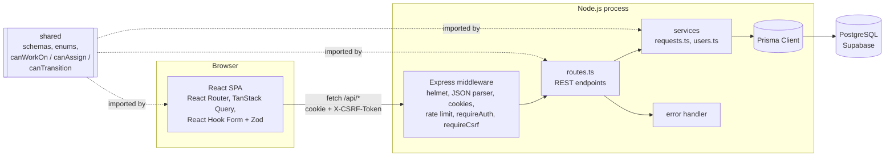
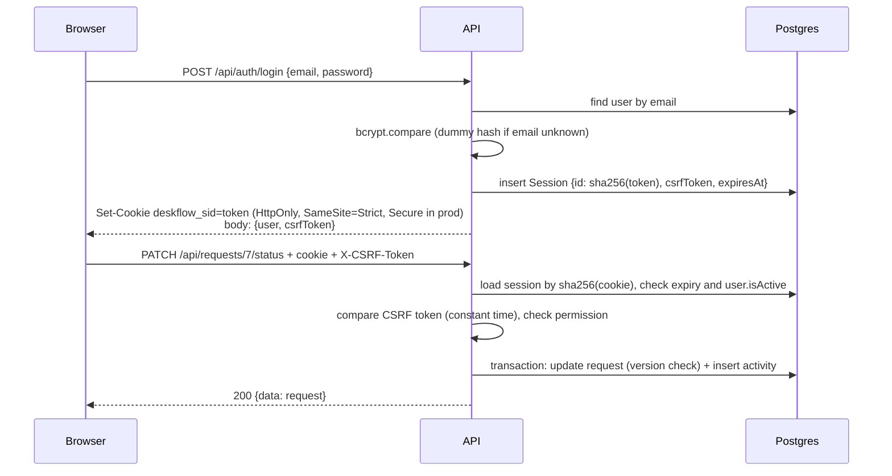

# Architecture

## Overview

DESKFLOW is a single-page React app talking to an Express REST API over JSON. The API owns every business rule and permission check and persists to PostgreSQL (Supabase) through Prisma. Live, it runs on Vercel: the client as static files and the API as one function on the same domain ([deployment.md](deployment.md)). A small `shared` package holds the Zod schemas, enums, lifecycle rules and permission helpers, so the client and server validate and decide the same way.

In development Vite serves the client on `:5173` and proxies `/api` to the API on `:4000`, so the browser sees one origin. In production the API serves the built client from `client/dist`, again one origin. No CORS is needed in either case.

## Frontend and backend communication

- Every endpoint is under `/api` and returns either `{ "data": ... }` or `{ "error": { "code", "message", "details?" } }`.
- Status codes: `400` validation, `401` not signed in or session expired, `403` not allowed or bad CSRF token, `404` missing, `409` stale version or duplicate, `422` business-rule violation (invalid transition, inactive assignee, resolved request), `429` too many sign-in attempts.
- The client wraps `fetch` in `client/src/lib/api.ts`. It adds the CSRF header on writes and turns errors into `ApiError`. Any `401` clears the cache and sends the user to sign-in with a `?next=` return path.
- TanStack Query caches reads. After a write, the affected lists, the request, its notes and activity, the dashboard and the team counts are refetched.
- List screens keep their filters in the URL. Search, filtering, sorting and pagination all run on the server.

### Endpoints

| Method | Path                                       | Who                                                                          |
| ------ | ------------------------------------------ | ---------------------------------------------------------------------------- |
| POST   | `/api/auth/login`                          | anyone (rate limited)                                                        |
| POST   | `/api/auth/logout`                         | signed in                                                                    |
| POST   | `/api/auth/logout-all`                     | signed in (ends every session of the caller)                                 |
| POST   | `/api/auth/password`                       | signed in (current password required)                                        |
| GET    | `/api/auth/me`                             | signed in                                                                    |
| GET    | `/api/users`                               | manager: everyone; employee: active, no emails                               |
| GET    | `/api/users/:id`, `/:id/insights`          | manager: anyone; employee: only themselves                                   |
| POST   | `/api/users`                               | manager                                                                      |
| POST   | `/api/users/:id/reset-password`            | manager (not for themselves)                                                 |
| DELETE | `/api/users/:id` (`confirmName`)           | manager; deactivated accounts only, not yourself                             |
| PATCH  | `/api/users/:id` (`isActive`)              | manager                                                                      |
| GET    | `/api/requests`                            | signed in (employees: only what they can see)                                |
| GET    | `/api/requests/:id`                        | signed in (404 if not visible)                                               |
| POST   | `/api/requests`                            | signed in (employees: no priority/deadline/owner)                            |
| PATCH  | `/api/requests/:id`                        | manager                                                                      |
| PATCH  | `/api/requests/:id/status`                 | manager (reopen) or assignee                                                 |
| PATCH  | `/api/requests/:id/assignment`             | manager                                                                      |
| GET    | `/api/requests/:id/notes`                  | signed in (404 if not visible)                                               |
| POST   | `/api/requests/:id/notes`                  | manager or assignee                                                          |
| GET    | `/api/requests/:id/activity`               | signed in (404 if not visible)                                               |
| GET    | `/api/activity?limit=`                     | signed in (visible requests only)                                            |
| GET    | `/api/analytics?range=7\|30\|90\|all`      | manager                                                                      |
| GET    | `/api/notifications`                       | signed in (your own only)                                                    |
| PATCH  | `/api/notifications/:id` (`read`)          | signed in (your own only)                                                    |
| POST   | `/api/notifications/read-all`              | signed in                                                                    |
| GET    | `/api/attention`                           | managers: all requests close to or past their deadline; employees: their own |
| GET    | `/api/requests/:id/recommendations`        | manager (suggestions only; never assigns)                                    |
| GET    | `/api/recommendations?category=&priority=` | manager (for the create form)                                                |
| GET    | `/api/dashboard`                           | signed in (counted over visible requests)                                    |
| GET    | `/api/health`                              | anyone                                                                       |

`GET /api/requests` accepts `q`, `status`, `priority`, `source`, `assignee` (`me`, `none` or a user id), `due` (`overdue`), `category`, `sort` (`createdAt`, `updatedAt`, `priority`, `referenceNumber`, `title`, `dueAt`; undated requests sort last), `order`, `page` and `pageSize` (max 100).

While a user still has a temporary password, every call except `/auth/me`, `/auth/password` and `/auth/logout` returns 403 `PASSWORD_CHANGE_REQUIRED`.

## Authentication flow

- The cookie holds a random 256-bit token. The database stores only its SHA-256, so a leaked database cannot be replayed as sessions.
- Sessions last 8 hours and slide forward when less than half the time is left. Expired sessions are rejected with `SESSION_EXPIRED` and purged hourly.
- Deactivating a user deletes their sessions in the same transaction, so they are signed out at once.
- CSRF: a per-session synchronizer token must match the `X-CSRF-Token` header on every non-GET call. The cookie is also `SameSite=Strict`. Login itself only accepts a JSON body, which a cross-site form cannot send.
- Role and identity always come from the session row. The server ignores anything the client says about who it is.

## Main modules

| Module                                 | Responsibility                                                                                                                                                                                |
| -------------------------------------- | --------------------------------------------------------------------------------------------------------------------------------------------------------------------------------------------- |
| `shared/src/domain.ts`                 | Enums, labels, `TRANSITIONS`, `canTransition`, `canWorkOn`, `canAssign`, `formatReference`                                                                                                    |
| `shared/src/schemas.ts`                | Zod schemas for every request body and query, used by both server and forms                                                                                                                   |
| `server/src/auth.ts`                   | Session create/verify/end, `requireAuth`, `requireCsrf`, `requireRole`                                                                                                                        |
| `server/src/routes.ts`                 | HTTP layer: parse, authorize, call a service, shape the response                                                                                                                              |
| `server/src/services/requests.ts`      | Lifecycle, assignment, edits, reference numbers, idempotent create, activity logging                                                                                                          |
| `server/src/services/users.ts`         | Team workload, user creation, deactivation (revoke sessions + release work), passwords, insights per person                                                                                   |
| `server/src/services/analytics.ts`     | Manager insights: key metrics, status and priority mix, categories, trend, inactive requests, workload and outcomes per employee, all computed from the database                              |
| `server/src/deadlines/*`               | Deadline & escalation: thresholds in `config.ts`, pure rules in `engine.ts`, the scheduled monitor, per-request evaluation and Needs attention in `monitor.ts` ([deadlines.md](deadlines.md)) |
| `server/src/services/notifications.ts` | Persistent in-app notifications with a unique de-duplication key per notification                                                                                                             |
| `server/src/recommendations/*`         | Smart assignment: weights in `config.ts`, pure scoring in `score.ts`, data gathering in `recommend.ts` ([recommendations.md](recommendations.md))                                             |
| `server/src/lib/errors.ts`             | `AppError`, Zod-to-400 mapping, central error handler that never leaks internals                                                                                                              |
| `client/src/lib/*`                     | API client, auth context, query hooks, formatting                                                                                                                                             |
| `client/src/components/*`              | Design-system primitives, status/priority badges, lifecycle rail, activity list, app shell                                                                                                    |
| `client/src/pages/*`                   | One file per screen                                                                                                                                                                           |

## Scheduled work

The API process runs two background jobs, both started in `server/src/index.ts`:

- **Session sweep** (hourly): deletes expired sessions.
- **Deadline monitor** (at startup, then every minute): updates deadline status and working priority, records automatic events in the history, and sends reminders. It keeps no state in memory; everything is in the database, so restarts and repeated runs are safe. It is also run for a single request right after each change to it. Details: [deadlines.md](deadlines.md).

A single API process is assumed. Running several would still not duplicate notifications (the database enforces unique keys), but they would all do the same work.

## Technical decisions and tradeoffs

| Decision                                                 | Why                                                                                                                                                                        | Tradeoff                                                                                            |
| -------------------------------------------------------- | -------------------------------------------------------------------------------------------------------------------------------------------------------------------------- | --------------------------------------------------------------------------------------------------- |
| Postgres (Supabase) + Prisma                             | Real relational DB with migrations, hosted for free, reachable from serverless functions through Supabase's pooler.                                                        | Needs a network database for local dev and tests too; each uses its own schema so nothing collides. |
| Prisma 6                                                 | Prisma 7 requires driver adapters and a new config file. Version 6 is stable and simpler to set up.                                                                        | Will need an upgrade eventually.                                                                    |
| Custom session table instead of `express-session`        | About 60 lines, typed, stores only token hashes, easy to revoke per user.                                                                                                  | Our own code to maintain instead of a library.                                                      |
| Server runs TypeScript through `tsx`                     | No build step; the `shared` package is consumed as source by both sides.                                                                                                   | Slightly slower cold start than compiled JS.                                                        |
| Optimistic concurrency (`version`)                       | Two people editing the same request cannot silently overwrite each other; the loser gets a clear `409` and the screen refreshes.                                           | Clients must send the version they read.                                                            |
| Idempotency key on create                                | Double-clicks, retries after a timeout and two tabs submitting the same form all produce one request.                                                                      | One extra unique column.                                                                            |
| Reference numbers from a counter row                     | The counter is incremented inside the create transaction; the counter row is locked by the update, so numbers never repeat. A concurrency test creates 8 requests at once. | Numbers are not reused if a create is rolled back. That is fine for a reference.                    |
| Business rule + audit write in one transaction           | The activity log can never disagree with the data.                                                                                                                         | Slightly longer transactions.                                                                       |
| Priority stored with a numeric rank                      | Sorting by priority gives Urgent > High > Normal > Low instead of alphabetical order.                                                                                      | One denormalised column, written by the service.                                                    |
| Unassigning an in-progress request moves it back to Open | "In progress" requires an owner (brief rule); the alternative would leave an impossible state.                                                                             | An extra activity entry explains it.                                                                |
| No hard deletes                                          | History has to stay intact, so foreign keys are `RESTRICT` and users are deactivated with their history kept.                                                              | Data only grows; acceptable at this scale.                                                          |
| URL-held list filters                                    | Filters survive reloads and can be shared as links.                                                                                                                        | None                                                                                                |
| Motion only where it explains a change                   | Lifecycle rail fill on status change, sliding nav indicator, list items entering/leaving, dialogs and drawer. Respects reduced-motion settings.                            | None                                                                                                |
