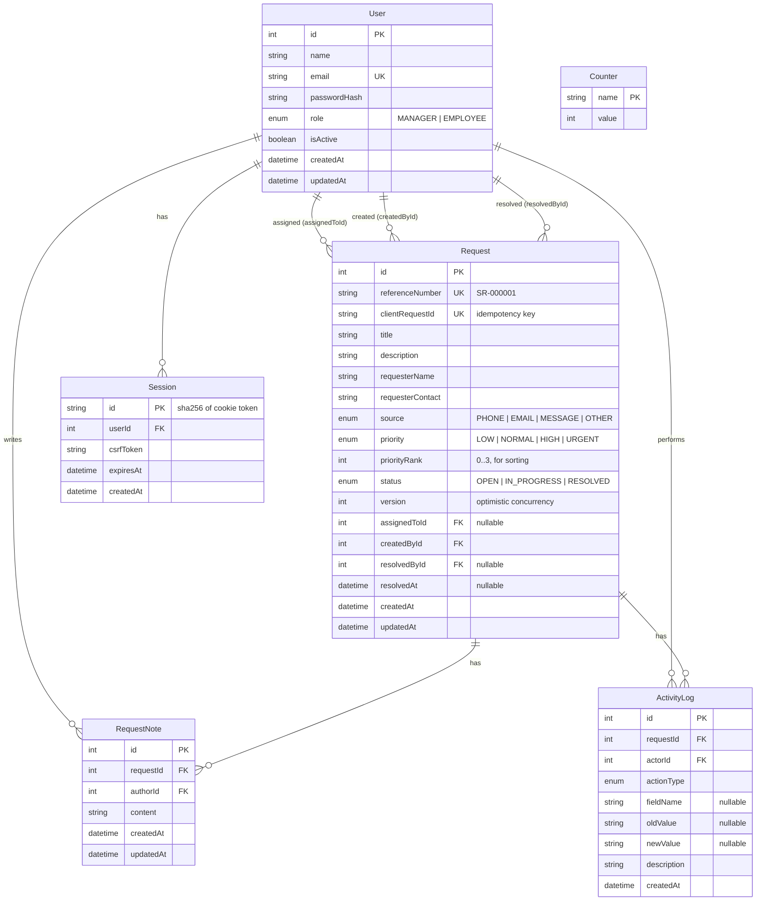

# Database

SQLite, managed by Prisma. Schema: [`server/prisma/schema.prisma`](../server/prisma/schema.prisma). Migrations: `server/prisma/migrations/`.

## Entity relationships

`ActivityLog.actionType` is one of `CREATED`, `UPDATED`, `PRIORITY_CHANGED`, `ASSIGNED`, `REASSIGNED`, `UNASSIGNED`, `STATUS_CHANGED`, `RESOLVED`, `REOPENED`.

## Foreign keys

| From                    | To           | On delete |
| ----------------------- | ------------ | --------- |
| `Request.assignedToId`  | `User.id`    | RESTRICT  |
| `Request.createdById`   | `User.id`    | RESTRICT  |
| `Request.resolvedById`  | `User.id`    | RESTRICT  |
| `RequestNote.requestId` | `Request.id` | RESTRICT  |
| `RequestNote.authorId`  | `User.id`    | RESTRICT  |
| `ActivityLog.requestId` | `Request.id` | RESTRICT  |
| `ActivityLog.actorId`   | `User.id`    | RESTRICT  |
| `Session.userId`        | `User.id`    | CASCADE   |

Nothing in the app deletes users, requests, notes or activity. `RESTRICT` makes sure a stray delete can never orphan history. Sessions are disposable, so they cascade.

## Constraints

- `User.email` unique. Emails are trimmed and lower-cased before saving and lookup.
- `Request.referenceNumber` unique; generated as `SR-` + six digits from the `Counter` row named `request`, inside the create transaction.
- `Request.clientRequestId` unique; a repeated create with the same key returns the existing request instead of a duplicate.
- Enums (`Role`, `Status`, `Priority`, `Source`, `ActionType`) are enforced by Prisma and by Zod at the API boundary.
- Passwords are stored only as bcrypt hashes (cost 12). Session tokens are stored only as SHA-256 hashes.

## Indexes

| Table       | Index                    | Serves                                 |
| ----------- | ------------------------ | -------------------------------------- |
| Request     | `status`                 | status filter, dashboard counts        |
| Request     | `(assignedToId, status)` | My requests, Unassigned, team workload |
| Request     | `priorityRank`           | sort by priority                       |
| Request     | `createdAt`, `updatedAt` | default sorts, recent lists            |
| RequestNote | `(requestId, createdAt)` | notes on a request, in order           |
| ActivityLog | `(requestId, createdAt)` | request history                        |
| ActivityLog | `createdAt`              | global recent activity feed            |
| Session     | `userId`                 | revoke all sessions for a user         |
| Session     | `expiresAt`              | purge expired sessions                 |

Unique constraints (`email`, `referenceNumber`, `clientRequestId`) also create indexes.

## Transactions

Every operation that changes a request runs in one Prisma interactive transaction together with its activity entries:

- create (counter increment + insert + `CREATED` and optional `ASSIGNED` activity)
- edit (version-checked update + one activity entry per changed field)
- status change (version-checked update + resolution fields + activity)
- assignment (version-checked update + optional automatic return to Open + activity)
- user deactivation (flag + delete sessions + release each unresolved request with activity)

The version check is an `updateMany ... where { id, version }`. If it matches zero rows, the transaction throws and rolls back and the API answers `409 STALE_VERSION`.

## Seed

`npm run db:seed` upserts four users by email and inserts 18 requests keyed by fixed `clientRequestId`s, each with backdated activity and notes. Running it again skips everything that exists.
