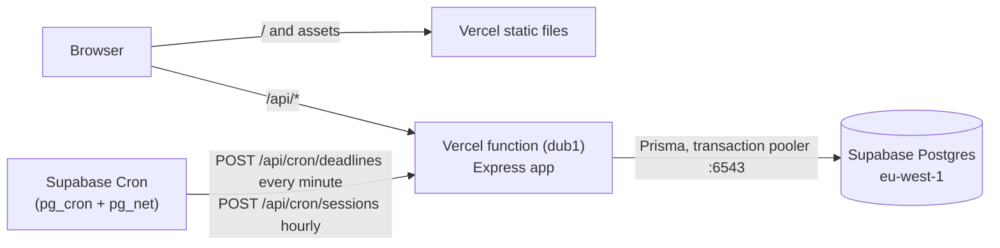

# Deployment (Vercel + Supabase)

Live: **https://deskflow-org.vercel.app**



- One Vercel project serves both halves on the same domain, so the session cookie stays first-party (`SameSite=Strict`, `Secure`) and no CORS is needed.
- `npm run vercel-build` ([scripts/vercel-build.mjs](../scripts/vercel-build.mjs)) writes the [Build Output API](https://vercel.com/docs/build-output-api/v3) folder `.vercel/output`:
  - `static/`: the built React app
  - `functions/api.func/`: the Express app ([server/src/vercel.ts](../server/src/vercel.ts)) bundled with esbuild, plus Prisma's Linux query engine. It runs in Dublin (`dub1`), next to the database.
  - `config.json`: real files first, then `/api/*` to the function, and everything else to `index.html`
- Functions don't keep running between requests, so the timers in `server/src/index.ts` (deadline monitor, session sweep) are replaced by Supabase Cron. It calls `POST /api/cron/deadlines` every minute and `POST /api/cron/sessions` hourly, with `Authorization: Bearer <CRON_SECRET>`. Without the right secret, those endpoints answer 404. Both jobs are safe to run repeatedly (see [deadlines.md](deadlines.md)). Requests are also re-checked immediately whenever they change.

## Vercel environment variables (Production)

| Variable            | Value                                                                              |
| ------------------- | ---------------------------------------------------------------------------------- |
| `DATABASE_URL`      | Supabase **transaction pooler** (port 6543) + `?pgbouncer=true&connection_limit=1` |
| `DIRECT_URL`        | Supabase **session pooler** (port 5432), used by migrations                        |
| `NODE_ENV`          | `production`                                                                       |
| `SESSION_TTL_HOURS` | `8`                                                                                |
| `TRUST_PROXY`       | `1` (one proxy hop, so rate limiting sees the real client IP)                      |
| `CRON_SECRET`       | Random string; the same value is in the Supabase Cron jobs                         |

`vercel.json` installs with `--include=dev`, because `NODE_ENV=production` would otherwise skip the build tools.

## Database layout (one Supabase project)

| Postgres schema | Used by                      |
| --------------- | ---------------------------- |
| `public`        | The live site                |
| `dev`           | Local `npm run dev`          |
| `test`          | API tests (wiped every run)  |
| `e2e`           | Playwright (wiped every run) |

## Deploying changes

- The Vercel project is connected to the GitHub repo: a push to `main` deploys to production. Without git, `npx vercel deploy --prod` from the repo root also works.
- After a schema change, apply migrations to the live schema before (or right after) deploying:
  `DATABASE_URL=<session pooler> DIRECT_URL=<session pooler> npx prisma migrate deploy` (in `server/`).
- Demo data: the same command with `npx tsx prisma/seed.ts` and `SEED_PASSWORD` set. It is idempotent.

## Scheduled jobs (SQL, run once in Supabase)

```sql
create extension if not exists pg_net;
create extension if not exists pg_cron;
select cron.schedule('deskflow-deadlines', '* * * * *', $$
  select net.http_post(
    url := 'https://deskflow-org.vercel.app/api/cron/deadlines',
    headers := '{"Authorization": "Bearer <CRON_SECRET>", "Content-Type": "application/json"}'::jsonb,
    body := '{}'::jsonb, timeout_milliseconds := 25000);
$$);
select cron.schedule('deskflow-sessions', '7 * * * *', $$
  select net.http_post(
    url := 'https://deskflow-org.vercel.app/api/cron/sessions',
    headers := '{"Authorization": "Bearer <CRON_SECRET>", "Content-Type": "application/json"}'::jsonb,
    body := '{}'::jsonb, timeout_milliseconds := 25000);
$$);
```

You can check them in the Supabase dashboard under **Integrations → Cron**, or with `select * from net._http_response order by created desc limit 5;`. To stop them: `select cron.unschedule('deskflow-deadlines'); select cron.unschedule('deskflow-sessions');`.

## Free-tier notes

- Supabase pauses a free project after about a week without activity. The cron ping counts as activity, but don't rely on that for more than a test.
- Vercel Hobby is for non-commercial use.
- After the test, rotate the database password (Supabase **Project Settings → Database**) and update `DATABASE_URL` and `DIRECT_URL` in Vercel and in `server/.env`.
